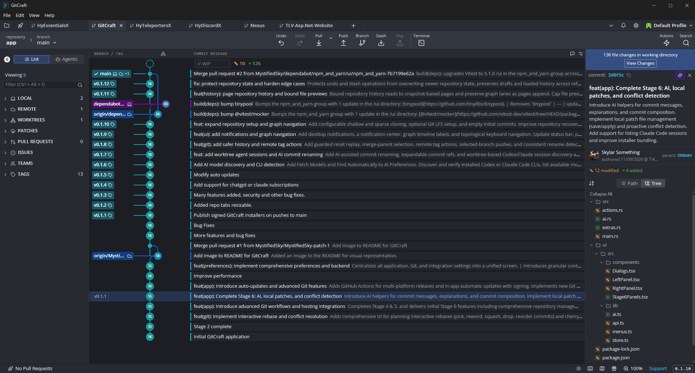

  

<h1 align="center">GitCraft</h1>

  <b>Your repository, from the big picture to the last changed line.</b> 
  Explore history, review changes, manage branches, and resolve conflicts 
  in one beautifully organized, open-source desktop app.

  
  
  
  
   
  
  
  

  <a href="https://github.com/MystifiedSky/GitCraft/releases/latest"><b>Download GitCraft</b></a> ·
  <a href="#features">Features</a> ·
  <a href="CONTRIBUTING.md#build-from-source-and-package">Build from source</a> ·
  <a href="docs/AI.md">AI setup</a> ·
  <a href="CHANGELOG.md">Changelog</a> ·
  <a href="CONTRIBUTING.md">Contribute</a>

  
   
  Your branches, history, and changes — together in one clear view.

## Features

<table>
  <tr>
    <td width="50%" valign="top">
      <h3>See the whole story</h3>
      Follow branches and merges through a colorful commit graph. Search by message, author, or commit, inspect changes, and trace a file's history with blame and comparisons. Choose the columns and branches you want to see.
    </td>
    <td width="50%" valign="top">
      <h3>Make every commit count</h3>
      Review diffs inline or side by side. Stage exactly what belongs together — whole files, individual hunks, or selected lines — then write, amend, or compose your commit without leaving the app.
    </td>
  </tr>
  <tr>
    <td width="50%" valign="top">
      <h3>Move confidently between branches</h3>
      Create and switch branches, merge, rebase, cherry-pick, and set work aside with stashes. Resolve conflicts in a three-pane editor, plan interactive rebases, and undo or redo supported local operations.
    </td>
    <td width="50%" valign="top">
      <h3>Bring your AI</h3>
      Generate commit and stash messages, explain changes, draft pull requests, and get help resolving conflicts. Connect your ChatGPT or Claude subscription through its CLI, an API provider, or a local model. AI is optional, with models configurable for each helper.
    </td>
  </tr>
  <tr>
    <td width="50%" valign="top">
      <h3>Keep every project within reach</h3>
      Work across repository tabs, favorites, workspaces, and profiles. Manage worktrees and submodules, open the built-in terminal, and pick up saved coding-agent sessions in their own worktrees.
    </td>
    <td width="50%" valign="top">
      <h3>Stay connected to your team</h3>
      Work with pull requests and issues through GitHub, GitLab, Bitbucket, Azure DevOps, Jira, and Trello integrations. Fetch, pull, and push using your existing Git setup, with an activity log when you want the details.
    </td>
  </tr>
</table>

**More tools, fewer interruptions.** Git LFS, sparse checkout, tags, patch import and export, early conflict checks, a command palette, four themes, and preferences for your editor, terminal, SSH, and signing. Signed updates download in the background and are ready when you restart.

## Download

GitCraft is available for **Windows, Linux, and macOS**.

| Windows | Linux | macOS |
| --- | --- | --- |
| x64 · Installer or MSI | x64 · AppImage, DEB, or RPM | Intel & Apple silicon · Universal DMG |

  <a href="https://github.com/MystifiedSky/GitCraft/releases/latest"><b>Get the latest release →</b></a>

Install Git and make sure it is available on `PATH`, then launch GitCraft and open a repository — or clone one to get started. Your existing Git credentials and configuration work with GitCraft.

Want AI assistance? Follow the [AI setup guide](docs/AI.md) to connect your preferred provider, discover available models, and configure your helpers.

## Make it yours

Choose a theme, shape the graph, and set up the tools that fit your workflow. GitCraft's Preferences bring Git, SSH, signing, external editors, terminals, AI providers, and repository settings together in one place.

## Contributing

Have an idea or found a bug? [Open an issue](https://github.com/MystifiedSky/GitCraft/issues). Code, documentation, and feedback are welcome — see [CONTRIBUTING.md](CONTRIBUTING.md) to build from source and get involved.

## License

GitCraft is free and open source under [GPL-3.0-only](LICENSE). Copyright © 2026 the GitCraft contributors. Third-party dependencies and bundled fonts retain their respective licenses.
